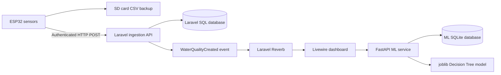

# Agwasuri Workspace Notes

## Overview

Agwasuri is an aquaculture monitoring system composed of three collaborating parts:

1. `agwasuri_prod`: Laravel web application and system of record.
2. `agwasuri_python`: FastAPI fish-species prediction and training service.
3. `agwasuri-hardware`: MicroPython sensor controller for field data collection.

The primary business flow is:



## Repository Structure

### `agwasuri_prod`

The main Laravel 11 application.

- `app/Http/Controllers`: HTTP and API controllers.
- `app/Livewire`: Dashboard, charts, water-quality cards, data tables, and fish classification UI.
- `app/Models`: Eloquent models for users, water-quality data, and ML metadata.
- `app/Services`: Shared application services, including chart data preparation.
- `app/Events`: Broadcast events such as `WaterQualityCreated`.
- `config`: Database, broadcasting, Reverb, water-quality thresholds, and service configuration.
- `database/migrations`: User, water-quality, model metadata, cache, jobs, and fishpond schemas.
- `resources/views`: Blade and Livewire views.
- `resources/js`: Vite, Livewire, Echo, chart, theme, and browser helpers.
- `routes`: Web, authentication, broadcast, and console routes.
- `tests`: Pest unit and feature tests.

### `agwasuri_python`

A separate FastAPI service for fish-species classification.

- Uses pandas, NumPy, scikit-learn, joblib, Pydantic, and SQLite.
- Stores training data and classification history in `optimal_fish_species.db`.
- Stores the trained model in `fish_species_model.joblib`.
- Provides `/predict`, `/train_model`, and `/` endpoints.

### `agwasuri-hardware`

MicroPython code for the field device.

- Reads temperature, dissolved oxygen, salinity, and pH sensors.
- Connects to Wi-Fi and initializes time.
- Writes readings to an SD card.
- Displays readings on an I2C LCD.
- Sends readings to Laravel every five seconds when connected.

## Key Business Modules

| Module                       | Responsibility                                                                     |
| ---------------------------- | ---------------------------------------------------------------------------------- |
| Sensor ingestion API         | Validates and stores readings submitted by field devices.                          |
| Water-quality domain         | Stores temperature, salinity, dissolved oxygen, pH, timestamp, and user ownership. |
| Live dashboard               | Displays current readings, trends, status, alerts, charts, and historical data.    |
| Water-quality classification | Compares readings with configured ranges and computes status and overall score.    |
| Real-time broadcasting       | Pushes new readings to connected dashboards through Reverb/WebSockets.             |
| Historical data              | Filters, summarizes, paginates, and exports stored readings.                       |
| User management              | Handles accounts, roles, profiles, fishpond details, and sensor API keys.          |
| Fish recommendations         | Sends averaged water-quality metrics to the ML service.                            |
| ML service                   | Trains and serves the fish-species Decision Tree model.                            |
| Hardware controller          | Collects sensor values, provides offline SD backup, and submits readings.          |

## Laravel Data Flow

1. The device creates a reading containing `user_id`, `recorded_at`, `temperature`, `salinity`, `dissolved_oxygen`, and `ph_level`.
2. The device sends the reading to `POST /store-water-quality-data` with a bearer API key.
3. `WaterQualityDataController` validates the fields and matches the API key to the specified user.
4. The reading is persisted as a `WaterQualityData` record.
5. Laravel broadcasts `WaterQualityCreated` on `water-quality-data-created`.
6. Livewire components update cards, tables, and charts for the selected user.
7. The chart can also load historical data through `GET /api/water-quality/latest`.

Relevant files:

- [`routes/web.php`](agwasuri_prod/routes/web.php)
- [`WaterQualityDataController.php`](agwasuri_prod/app/Http/Controllers/Api/WaterQualityDataController.php)
- [`WaterQualityCreated.php`](agwasuri_prod/app/Events/WaterQualityCreated.php)
- [`WaterQualityData.php`](agwasuri_prod/app/Models/WaterQualityData.php)
- [`User.php`](agwasuri_prod/app/Models/User.php)

## ML Data Flow

Laravel calls the external ML service at `https://api.agwasuri.app`.

- `/predict` receives averaged temperature, dissolved oxygen, salinity, and pH values.
- `/train_model` retrains the Decision Tree model.
- Training timestamps are copied back into Laravel's `model_metadata` table.
- The ML service maintains its own SQLite database; it does not share Laravel's database directly.

Relevant files:

- [`ClassifyFish.php`](agwasuri_prod/app/Livewire/ClassifyFish.php)
- [`RecommendationController.php`](agwasuri_prod/app/Http/Controllers/Api/RecommendationController.php)
- [`main.py`](agwasuri_python/main.py)
- [`requirements.txt`](agwasuri_python/requirements.txt)

## Dependencies

### PHP / Laravel

Defined in [`composer.json`](agwasuri_prod/composer.json):

- PHP `^8.2`; PHP 8.3+ is recommended by the project documentation.
- Laravel Framework `^11.31`.
- Livewire `^3.4` and Livewire Volt `^1.0`.
- Laravel Reverb `^1.0`.
- `asantibanez/livewire-charts` `^4.1`.
- Laravel Tinker.
- Pest, PHPUnit integration, Faker, Mockery, Pint, Sail, and Collision for development.

### JavaScript

Defined in [`package.json`](agwasuri_prod/package.json):

- Node.js 18+ and npm.
- Vite and Laravel Vite Plugin.
- Tailwind CSS and PostCSS.
- Laravel Echo and Pusher client for Reverb.
- ApexCharts and Chart.js charting libraries.
- Luxon and Chart.js adapters.
- Playwright for browser smoke testing.
- Axios, Sharp, Concurrently, and frontend tooling.

### Python

Defined in [`requirements.txt`](agwasuri_python/requirements.txt):

- FastAPI and Uvicorn.
- Pydantic.
- pandas and NumPy.
- scikit-learn.
- joblib.
- SQLite support.

## Local Environment

Copy the Laravel environment template and generate an application key:

```powershell
Set-Location .\agwasuri_prod
Copy-Item .env.example .env
php artisan key:generate
```

The template defaults to MySQL. For the simplest local setup, use SQLite:

```env
DB_CONNECTION=sqlite
DB_DATABASE=database/database.sqlite
```

Create the SQLite file:

```powershell
New-Item -ItemType File database\database.sqlite -Force
```

Important Laravel settings:

```env
APP_ENV=local
APP_DEBUG=true
APP_URL=http://localhost
SESSION_DRIVER=database
QUEUE_CONNECTION=database
CACHE_STORE=database
BROADCAST_CONNECTION=log
```

For local Reverb/WebSocket support, configure values consumed by `config/reverb.php` and `resources/js/echo.js`:

```env
REVERB_APP_ID=
REVERB_APP_KEY=
REVERB_APP_SECRET=
REVERB_HOST=127.0.0.1
REVERB_PORT=8080
REVERB_SCHEME=http
REVERB_SERVER_HOST=0.0.0.0
REVERB_SERVER_PORT=8080

VITE_REVERB_APP_KEY="${REVERB_APP_KEY}"
VITE_REVERB_HOST="${REVERB_HOST}"
VITE_REVERB_PORT="${REVERB_PORT}"
VITE_REVERB_SCHEME="${REVERB_SCHEME}"
```

## Install and Run

From `agwasuri_prod`:

```powershell
composer install
npm install
php artisan migrate --seed
php artisan reverb:install
php artisan livewire-charts:install
```

Start Laravel, Reverb, and Vite together:

```powershell
composer run dev
```

Or start them separately:

```powershell
php artisan serve --host=127.0.0.1 --port=8000
php artisan reverb:start
npm run dev
```

The application is available at <http://127.0.0.1:8000>.

The Windows helper performs environment preparation and migrations:

```powershell
npm run dev-start:win
```

Destructive database reset:

```powershell
pwsh .\scripts\dev-start.ps1 -Fresh
```

## Build Commands

```powershell
npm run build
npm run build:theme
```

Other available commands:

```powershell
npm run dev-start
npm run dev-reset
npm run convert-webp
```

## Testing

Backend tests use Pest/PHPUnit:

```powershell
php artisan test
.\vendor\bin\pest
```

Test configuration is in [`phpunit.xml`](agwasuri_prod/phpunit.xml). For an isolated SQLite test database:

```powershell
$env:DB_CONNECTION = "sqlite"
$env:DB_DATABASE = ":memory:"
php artisan test
```

Playwright is installed but no npm test script is defined. The available smoke test is:

```powershell
node .\scripts\playwright-smoke.js
```

Start the Laravel application before running the smoke test.

## Optional ML Service Setup

From the workspace root:

```powershell
Set-Location .\agwasuri_python
python -m pip install -r requirements.txt
uvicorn main:app --reload --host 127.0.0.1 --port 8001
```

Laravel currently uses the hard-coded production ML URL. To use the local FastAPI service, update the endpoints in `agwasuri_prod/app/Livewire/ClassifyFish.php`.

## Testing Without Physical Hardware

The hardware is not required for web testing. Post sample data to:

```text
POST http://127.0.0.1:8000/store-water-quality-data
```

Required headers:

```text
Authorization: Bearer <API_KEY>
Content-Type: application/json
```

Example payload:

```json
{
  "user_id": 1,
  "recorded_at": "2025-11-06 12:00:00",
  "temperature": 28.5,
  "ph_level": 7.2,
  "dissolved_oxygen": 6.8,
  "salinity": 15.3
}
```

## Integration Caveats

- Broadcasting defaults to `null` or `log` depending on the environment template; Reverb must be configured for browser real-time updates.
- The sensor endpoint is publicly routed, but bearer-key validation happens inside the controller.
- The active hardware `DataController` includes the bearer token; the older `api_controller.py` helper does not.
- The hardware API key is stored in `agwasuri-hardware/config.json` and must be configured locally.
- Laravel and the ML service use separate databases and communicate over HTTP.
- The `.env.example` database defaults are MySQL, while the README recommends SQLite for quick local development.
